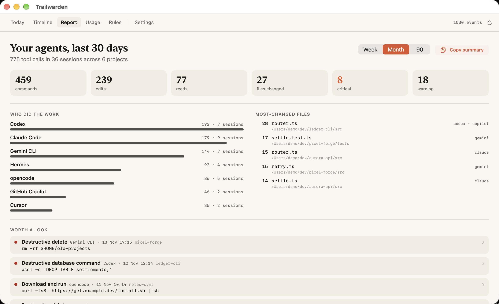
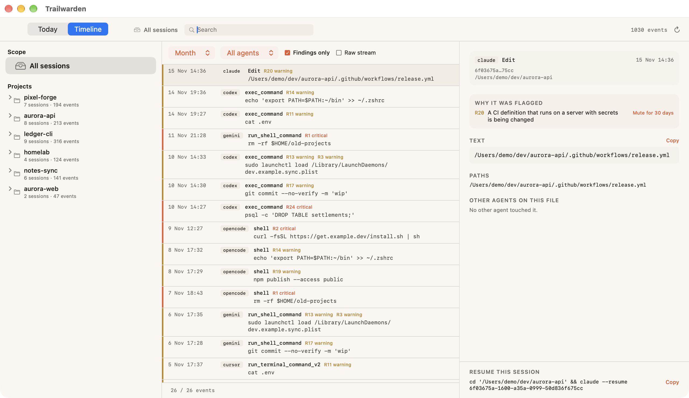
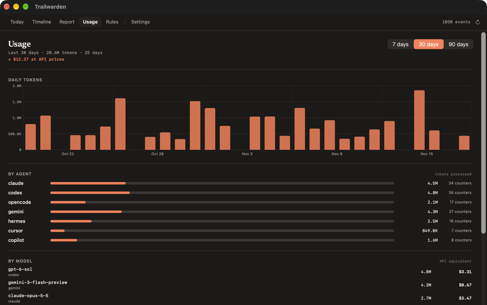

<!-- SPDX-License-Identifier: Apache-2.0 -->

# Trailwarden

[](https://github.com/tnalbant/trailwarden/actions/workflows/ci.yml) [](https://github.com/tnalbant/trailwarden/releases/latest)  [](LICENSE)

[English](README.md) · [Türkçe](README.tr.md) · **Deutsch** · [Español](README.es.md) · [Italiano](README.it.md) · [Français](README.fr.md)

**Das Prüfprotokoll für deine Coding-Agenten.** Claude Code, Codex, Gemini CLI,
opencode, Cursor, GitHub Copilot und Hermes Agent schreiben schon jetzt alles mit, was sie auf deinem Mac tun. Trailwarden liest
diese Transkripte, sagt dir in dem Moment Bescheid, in dem ein Agent etwas Riskantes ausführt, zeigt, welcher
Agent welche Datei angefasst hat, und macht aus einem Monat Agentenarbeit eine einzige Seite, die du
lesen kannst – oder geschwärzt an andere weitergeben.

Nichts über deine Agenten verlässt den Rechner: kein Konto, kein Server, keine
Telemetrie. Der einzige Netzwerkzugriff der App ist die Update-Prüfung – ein GET auf eine
kleine JSON-Datei im neuesten GitHub-Release, ausgelöst per Klick oder, wenn du es
in den Einstellungen einschaltest, höchstens wöchentlich oder monatlich (standardmäßig aus) – und die CI schlägt fehl,
sobald irgendwo sonst in `Sources/` eine Netzwerk-API auftaucht.

> Status: **v0.2.4** – Live-Wächter, 27 Regeln, Agent-Blame, Bericht, CI-Gate.
> Oberfläche auf Englisch (US), Türkisch, Deutsch, Spanisch, Italienisch und Französisch.



## Warum

Ein Agent, der über Nacht 400 Befehle ausgeführt hat, hinterlässt drei Dinge: rohe `.jsonl`-Dateien,
einen langen Chat und ein ungutes Gefühl. Trailwarden beantwortet die Fragen, um die es bei
diesem Gefühl geht:

| Frage | Wo |
|---|---|
| Hat ein Agent gerade etwas getan, das ich gestoppt hätte? | **Live-Wächter** – eine Benachrichtigung innerhalb von Sekunden |
| Welcher Agent hat diese Datei wann geändert? | `trailwarden who <file>` · Detailbereich · MCP |
| Was haben meine Agenten diesen Monat getan? | **Bericht** |
| Kann die CI fehlschlagen, wenn ein Agent etwas Riskantes getan hat? | `trailwarden scan --fail-on critical` |
| Was genau lief, und wie setze ich diese Sitzung fort? | **Zeitleiste** + Befehl zum Fortsetzen |

## Screenshots

Hell, mit der Zeitleiste, den Filtern und dem Inspektor:



Dunkel, in der Ansicht „Nutzung“:



Jeder Screenshot entsteht auf einer erfundenen Datenbank (`scripts/seed-demo.py`),
sodass darin kein echtes Projekt zu sehen ist.

## Was es kann

- **Live-Wächter** – FSEvents meldet Trailwarden in dem Moment, in dem ein Agent an sein
  Transkript anhängt; die neuen Zeilen werden geparst, die Regeln laufen, und ein kritischer Befund
  wird zu einer macOS-Benachrichtigung. Ein Klick darauf öffnet die Zeitleiste an diesem Ereignis.
  Kein Polling, kein Daemon, und nichts wird irgendwohin gesendet. Derselbe Strom ist im
  Terminal verfügbar: `trailwarden watch`.
- **27 Risikoregeln** – zerstörerische Löschbefehle, `curl … | sh`, Zugriffe auf Geheimnisse und den Schlüsselbund,
  in einen Befehl eingefügte API-Schlüssel, `--dangerously-skip-permissions`,
  `git commit --no-verify`, launchd-/cron-Persistenz, Änderungen an Shell-Startdateien und Agent-
  Einstellungen, Änderungen an CI-Workflows, `DROP TABLE`, `terraform destroy`, Datenträger-
  löschung, Reverse Shells, abgeschaltetes Gatekeeper/SIP und ein Agent, der seine
  eigenen Transkripte löscht. Jede Regel ist Daten in [`rules.json`](Sources/TrailwardenCore/Resources/rules.json)
  und hat eine Tabelle mit Befehlen, die treffen müssen und nicht treffen dürfen.
- **Agent-Blame** – `trailwarden who src/App.swift` listet jeden Agenten auf, der eine Datei
  geändert, gelesen oder einen Befehl auf ihr ausgeführt hat, neueste zuerst, mit dem Befehl, um
  die Sitzung fortzusetzen, die sie zuletzt geändert hat. Funktioniert auch mit Ordnern.
- **Bericht** – ein Monat Agentenarbeit auf einer Seite: Befehle, Änderungen, geänderte
  Dateien, wer die Arbeit gemacht hat, die am häufigsten geänderten Dateien und die Befunde, die einen
  Blick wert sind. „Zusammenfassung kopieren“ liefert nur Zahlen und Regelnamen, sicher zum Einfügen.
- **Zeitleiste** – jede Sitzung, jeder Tool-Aufruf, nach Projekt gruppiert, mit dem
  Branch und dem Arbeitsverzeichnis, in dem der Agent lief.
- **CI-Gate** – `trailwarden scan --since 1d --fail-on critical` beendet sich mit 1, wenn ein
  Befund auf oder über der Schwelle im Zeitfenster liegt.
- **Audit-Export** – `trailwarden export --md` erzeugt ein lesbares, geschwärztes
  Protokoll für einen Zeitraum (API-Schlüssel, Tokens, private Schlüssel und lange Base64-Blöcke
  werden maskiert; Pfade im Home-Verzeichnis werden zu `~` gekürzt).
- **Nutzung** – ein Token-Diagramm über 30 Tage und eine Aufschlüsselung pro Agent, aus den Zählern,
  die die Agenten ohnehin schreiben. Es wird kein Preis ausgegeben: Derselbe Token kostet je nach
  Tarif und Modell unterschiedlich viel.
- **Fortsetzen** – der genaue Befehl, um eine Sitzung weiterzuführen (`claude --resume`,
  `codex resume`, `gemini --resume`, `opencode --session`, `hermes --resume`),
  in Anführungszeichen gesetzt und fertig zum Kopieren.
- **MCP-Server** – `trailwarden-mcp` spricht JSON-RPC über stdio, damit andere Agenten
  dieselben Fragen stellen können (`search_events`, `list_sessions`, `get_event`,
  `file_history`, `audit_summary`). Mit `file_history` kann ein Agent prüfen, wer sonst
  an einer Datei arbeitet, bevor er sie bearbeitet.

Der neuere „Code Mode“ von Codex verpackt jeden Aufruf in ein kleines JavaScript-Programm;
Trailwarden liest die Shell-Befehle und gepatchten Dateien daraus, sodass die
Zeitleiste `git push --force` zeigt und nicht `text(await tools.exec_command({cmd:…`.
Codex komprimiert ältere Sitzungen zu `.jsonl.zst`; Trailwarden liest auch diese,
mit dem offiziellen Zstandard-Decoder, der eingebaut ist (keine zusätzliche Installation), sodass Monate
an Codex-Verlauf in der Zeitleiste nicht fehlen.

Agenten, die ihren Verlauf in SQLite speichern (Hermes: `~/.hermes/state.db`, opencode:
`~/.local/share/opencode/opencode.db`), werden ab der zuletzt
gelesenen Stelle weitergelesen, sodass ein Scan nur parst, was neu ist. Gelesen werden nur die Verlaufstabellen;
die Tabelle `credential` von opencode wird nie geöffnet.

Cursor legt seine Agent-Chats in der Zustandsdatenbank des Editors ab
(`~/Library/Application Support/Cursor/User/globalStorage/state.vscdb`).
Trailwarden liest darin nur die Chat- und Schritt-Datensätze (`composerData:*`,
`bubbleId:*`) – nie die Editor-Einstellungen oder Anmeldedaten, die daneben liegen.
Der Agent von GitHub Copilot (die Copilot CLI und die Copilot-App) schreibt pro
Sitzung ein Log unter `~/.copilot/session-state/<id>/events.jsonl`; dieses Log wird
wie jedes Transkript gelesen. Copilot Chat in VS Code wird noch nicht gelesen.

Trailwarden ist ein **rein lesender Beobachter**: Es startet keine Agenten, fängt sie nicht
ab und verändert ihre Dateien nicht. Es liest `~/.claude`, `~/.codex`, `~/.gemini`,
`~/.copilot` und die oben genannten Datenbanken so, wie du es auch tun würdest, und führt seinen eigenen SQLite-Index unter
`~/Library/Application Support/Trailwarden/`.

## Installation

```bash
brew trust tnalbant/trailwarden   # once: recent Homebrew asks before using a third-party tap
brew tap tnalbant/trailwarden     # once
```

| Methode | Installiert |
|---|---|
| `brew install --cask trailwarden` | Menüleisten-App |
| `brew install trailwarden-cli` | CLI + MCP-Server |
| DMG von [Releases](https://github.com/tnalbant/trailwarden/releases) | Menüleisten-App |
| `npm install -g trailwarden-mcp` | MCP-Server |
| `git clone … && make install` | CLI + MCP-Server |

Siehe [docs/INSTALL.md](docs/INSTALL.md) (Englisch) für jede Methode, auch dafür, wie du
den MCP-Server in einen Client einbindest.

## Voraussetzungen

- macOS 14 (Sonoma) oder neuer
- Swift-6-Toolchain (Xcode 16+) beim Bauen aus dem Quellcode

## Kommandozeile

```bash
trailwarden scan                           # index new transcript lines, list findings
trailwarden watch                          # live: print each finding as it happens
trailwarden who Sources/App.swift          # which agent touched this file
trailwarden scan --since 1d --fail-on warn # CI gate: exit 1 on a warning or worse
trailwarden export --md --since 7d > audit.md
trailwarden rules test "git push --force origin main"
trailwarden rules apply                    # re-run the rules over the whole index
trailwarden doctor
```

Exit-Codes: `0` sauber, `1` Befunde auf oder über `--fail-on` (Standard `critical`),
`2` Aufruffehler.

## Ausprobieren ohne eigene Daten

```bash
swift build
python3 scripts/seed-demo.py /tmp/trailwarden-demo.sqlite   # 30 invented days, real rules

# after `xcodegen generate` + an xcodebuild, point the app at the demo index:
TRAILWARDEN_DB=/tmp/trailwarden-demo.sqlite \
  "$(xcodebuild -project Trailwarden.xcodeproj -scheme Trailwarden -configuration Debug \
      -showBuildSettings 2>/dev/null | awk -F' = ' '/ BUILT_PRODUCTS_DIR/ {print $2; exit}')/Trailwarden.app/Contents/MacOS/Trailwarden"
```

Die CLI liest dieselbe Datei: `trailwarden who --db /tmp/trailwarden-demo.sqlite src/router.ts`.

`TRAILWARDEN_DB` richtet die App, die CLI und den MCP-Server auf einen anderen Index –
die Demo oder eine für einen Fehlerbericht angefertigte Kopie; auf der Kommandozeile hat `--db` Vorrang. Der Live-Wächter bleibt bei einem solchen Index aus (er würde deine
echten Transkripte hineinschreiben), es sei denn, `TRAILWARDEN_LIVE=1` ist gesetzt.

## Entwicklung

```bash
swift build          # TrailwardenCore, trailwarden (CLI), trailwarden-mcp
swift test
xcodegen generate    # produces Trailwarden.xcodeproj for the menu-bar app
open Trailwarden.xcodeproj
```

Das Xcode-Projekt wird generiert und nicht eingecheckt: `project.yml` ist die
maßgebliche Quelle. Installiere XcodeGen mit `brew install xcodegen`.

### Aufbau

```
Sources/TrailwardenCore   parsers, event model, rule engine, store, redaction
Sources/CZstd             vendored Zstandard decompressor (BSD-3-Clause, unmodified)
Sources/TrailwardenCLI    `trailwarden` command line tool
Sources/TrailwardenMCP    stdio MCP server
Sources/TrailwardenApp    SwiftUI menu-bar app (driven by project.yml)
Tests/                  synthetic fixtures only — real transcripts are never committed
```

## Datenschutz

Trailwarden ist für Leute gebaut, die nicht wollen, dass ihre Agent-Transkripte irgendwohin
hochgeladen werden. Daraus folgen zwei Regeln, die in der CI durchgesetzt werden:

1. Kein Netzwerkcode in `Sources/` außer der Update-Prüfung in
   `Sources/TrailwardenApp/Update/UpdateChecker.swift`, die läuft, wenn du darauf
   klickst, oder nach dem wöchentlichen/monatlichen Zeitplan, den du in den Einstellungen einschalten kannst (standardmäßig
   aus). Die CI erzwingt beide Hälften: Eine Netzwerk-API an anderer Stelle lässt den Build fehlschlagen,
   und wenn diese Datei ihre Existenzberechtigung verliert, ebenfalls. Der Live-Wächter nutzt
   FSEvents (Dateiänderungs-Benachrichtigungen vom Kernel) und lokale Benachrichtigungen;
   keines von beiden berührt das Netzwerk.
2. Kein echtes `.jsonl`-Transkript im Repository; Tests verwenden ausschließlich von Hand geschriebene
   synthetische Fixtures.

Die Index-Datenbank und jeder Export werden mit dem Modus `0600` geschrieben. Das Bedrohungsmodell
und der Meldeprozess stehen in [THREATMODEL.md](THREATMODEL.md) und
[SECURITY.md](SECURITY.md).

## Lizenz

Apache-2.0. Jede Quelldatei trägt einen SPDX-Header.

### Software von Drittanbietern

- [swift-argument-parser](https://github.com/apple/swift-argument-parser)
  (Apache-2.0), nur für die Kommandozeile.
- [Zstandard](https://github.com/facebook/zstd) v1.5.7, nur der Dekompressor,
  Copyright (c) Meta Platforms, Inc. and affiliates, verwendet unter der
  BSD-3-Clause-Lizenz. Der Lizenztext steht in
  [Sources/CZstd/LICENSE](Sources/CZstd/LICENSE) und liegt in der App als
  `Acknowledgements.txt` bei.
