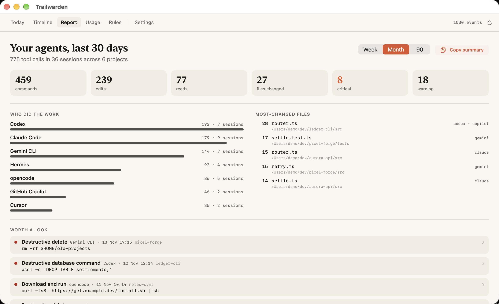
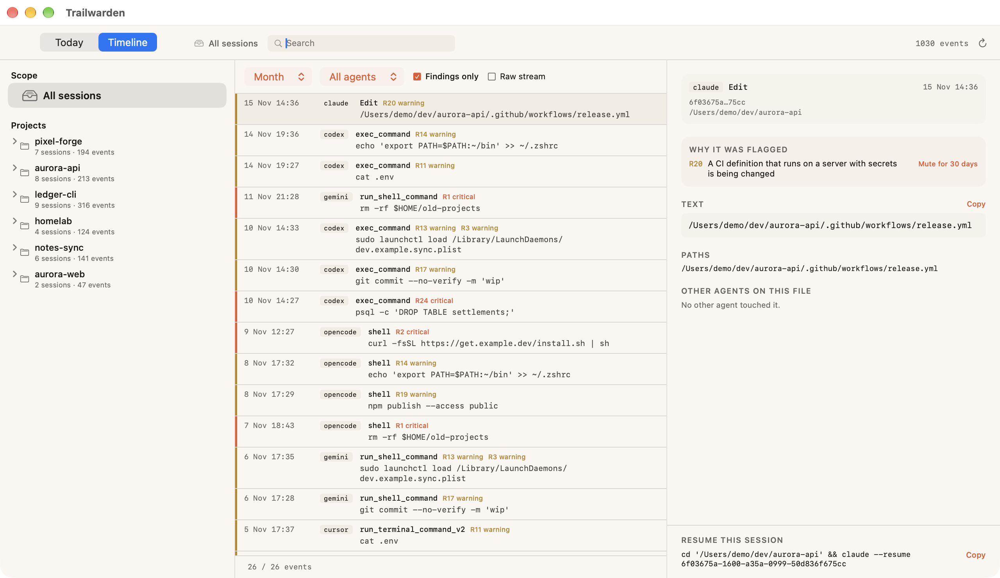
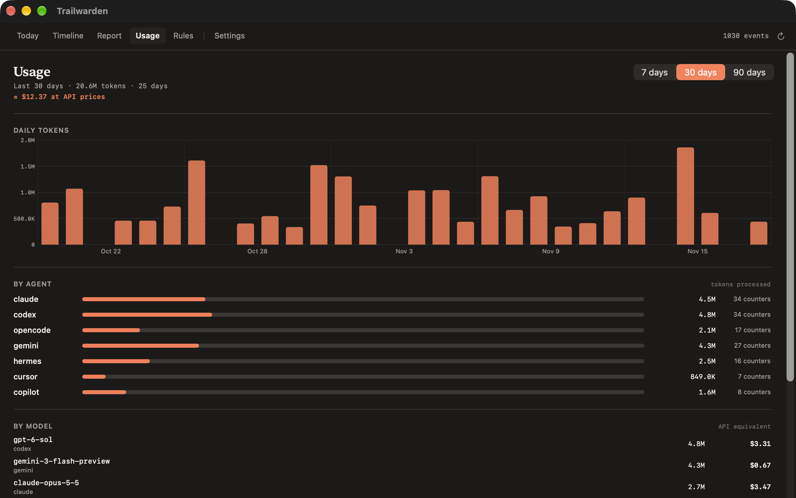

<!-- SPDX-License-Identifier: Apache-2.0 -->

# Trailwarden

[](https://github.com/tnalbant/trailwarden/actions/workflows/ci.yml) [](https://github.com/tnalbant/trailwarden/releases/latest)  [](LICENSE)

[English](README.md) · [Türkçe](README.tr.md) · [Deutsch](README.de.md) · **Español** · [Italiano](README.it.md) · [Français](README.fr.md)

**El registro de auditoría de tus agentes de programación.** Claude Code, Codex, Gemini CLI,
opencode, Cursor, GitHub Copilot y Hermes Agent ya anotan en tu Mac todo lo que hacen. Trailwarden lee
esas transcripciones, te avisa en cuanto un agente ejecuta algo arriesgado, muestra qué
agente tocó qué archivo y convierte un mes de trabajo de agentes en una sola página que puedes
leer, o entregar a otra persona, con los datos enmascarados.

Nada sobre tus agentes sale de tu máquina: sin cuenta, sin servidor, sin
telemetría. La única petición de red de la app es la búsqueda de actualizaciones: un GET a un
pequeño archivo JSON de la última versión en GitHub, que se hace cuando pulsas el botón o, si lo
activas en Ajustes, como mucho una vez por semana o por mes (desactivado por defecto). Además, la CI falla si aparece
una API de red en cualquier otro punto de `Sources/`.

> Estado: **v0.2.4** — vigía en vivo, 27 reglas, agent blame, informe, control en CI.
> Interfaz en inglés (EE. UU.), turco, alemán, español, italiano y francés.



## Por qué

Un agente que ejecutó 400 comandos durante la noche deja tres cosas: archivos `.jsonl`
sin procesar, una conversación larga y una sensación vaga. Trailwarden responde a las preguntas
que hay detrás de esa sensación:

| Pregunta | Dónde |
|---|---|
| ¿Acaba de hacer un agente algo que yo habría detenido? | **Vigía en vivo**: una notificación en cuestión de segundos |
| ¿Qué agente cambió este archivo y cuándo? | `trailwarden who <file>` · panel de detalle · MCP |
| ¿Qué hicieron mis agentes este mes? | **Informe** |
| ¿Puede fallar la CI cuando un agente hizo algo arriesgado? | `trailwarden scan --fail-on critical` |
| ¿Qué se ejecutó exactamente y cómo retomo esa sesión? | **Cronología** + comando para retomar |

## Capturas de pantalla

En modo claro, con la cronología, los filtros y el inspector:



En modo oscuro, en la pantalla de uso:



Todas las capturas se hacen sobre una base de datos inventada (`scripts/seed-demo.py`),
así que no aparece ningún proyecto real.

## Qué hace

- **Vigía en vivo**: FSEvents avisa a Trailwarden en cuanto un agente añade algo a su
  transcripción; se analizan las líneas nuevas, se ejecutan las reglas y un hallazgo
  crítico se convierte en una notificación de macOS. Si haces clic en ella, la cronología se abre en ese evento.
  Sin sondeo, sin daemon y sin enviar nada a ningún sitio. El mismo flujo está disponible en la
  terminal: `trailwarden watch`.
- **27 reglas de riesgo**: borrados destructivos, `curl … | sh`, lecturas de secretos y del
  llavero, claves de API pegadas en un comando, `--dangerously-skip-permissions`,
  `git commit --no-verify`, persistencia con launchd/cron, ediciones de los archivos de arranque del shell y de los
  ajustes de agentes, ediciones de workflows de CI, `DROP TABLE`, `terraform destroy`, borrado
  de disco, shells inversas, Gatekeeper/SIP desactivados y un agente que borra sus
  propias transcripciones. Cada regla es un dato en [`rules.json`](Sources/TrailwardenCore/Resources/rules.json)
  y tiene una tabla de comandos que deben coincidir y que no deben coincidir.
- **Agent blame**: `trailwarden who src/App.swift` lista todos los agentes que
  modificaron, leyeron o ejecutaron un comando sobre un archivo, del más reciente al más antiguo, con el comando para
  retomar la última sesión que lo modificó. También funciona con carpetas.
- **Informe**: un mes de trabajo de agentes en una página: comandos, ediciones, archivos
  modificados, quién hizo el trabajo, los archivos más modificados y los hallazgos que merecen
  un vistazo. «Copiar resumen» te da solo recuentos y nombres de reglas, seguro para pegar.
- **Cronología**: todas las sesiones, todas las llamadas a herramientas, agrupadas por proyecto, con la
  rama y el directorio de trabajo en que se ejecutó el agente.
- **Control en CI**: `trailwarden scan --since 1d --fail-on critical` termina con código 1 cuando hay un
  hallazgo igual o superior al umbral dentro del intervalo.
- **Exportación de auditoría**: `trailwarden export --md` genera un registro legible y enmascarado
  para un intervalo de fechas (se enmascaran claves de API, tokens, claves privadas y bloques largos de base64;
  las rutas del directorio personal se abrevian a `~`).
- **Uso**: un gráfico de tokens de 30 días y un desglose por agente, a partir de los contadores
  que los agentes ya escriben. No se muestra ningún precio: el mismo token vale distinto
  según el plan y el modelo.
- **Retomar**: el comando exacto para continuar desde una sesión (`claude --resume`,
  `codex resume`, `gemini --resume`, `opencode --session`, `hermes --resume`),
  entrecomillado y listo para copiar.
- **Servidor MCP**: `trailwarden-mcp` habla JSON-RPC por stdio para que otros agentes
  puedan hacer las mismas preguntas (`search_events`, `list_sessions`, `get_event`,
  `file_history`, `audit_summary`). `file_history` permite a un agente comprobar quién más
  trabaja en un archivo antes de editarlo.

El «code mode» más reciente de Codex envuelve cada llamada en un pequeño programa de JavaScript;
Trailwarden extrae de él los comandos de shell y los archivos modificados con parches, de modo que la
cronología muestra `git push --force` y no `text(await tools.exec_command({cmd:…`.
Codex comprime las sesiones antiguas a `.jsonl.zst`; Trailwarden también las lee,
con el decodificador oficial de Zstandard incluido (sin instalar nada más), así que meses de
historial de Codex no faltan en la cronología.

Los agentes que guardan su historial en SQLite (Hermes: `~/.hermes/state.db`, opencode:
`~/.local/share/opencode/opencode.db`) se leen de forma incremental mediante una
marca de agua, de modo que un análisis solo procesa lo nuevo. Solo se leen las tablas de historial;
la tabla `credential` de opencode nunca se abre.

Cursor guarda sus conversaciones de agente en la base de datos de estado del editor
(`~/Library/Application Support/Cursor/User/globalStorage/state.vscdb`).
Trailwarden lee solo los registros de conversaciones y pasos que contiene (`composerData:*`,
`bubbleId:*`), nunca los ajustes del editor ni los datos de inicio de sesión almacenados junto a ellos.
El agente de GitHub Copilot (la CLI de Copilot y la app de Copilot) escribe un registro por
sesión en `~/.copilot/session-state/<id>/events.jsonl`; ese registro se lee
como cualquier otra transcripción. Copilot Chat dentro de VS Code todavía no se lee.

Es un **observador de solo lectura**: Trailwarden no ejecuta agentes, no los intercepta
y no modifica sus archivos. Lee `~/.claude`, `~/.codex`, `~/.gemini`,
`~/.copilot` y las bases de datos anteriores igual que lo harías tú, y mantiene su propio índice SQLite en
`~/Library/Application Support/Trailwarden/`.

## Instalación

```bash
brew trust tnalbant/trailwarden   # once: recent Homebrew asks before using a third-party tap
brew tap tnalbant/trailwarden     # once
```

| Método | Instala |
|---|---|
| `brew install --cask trailwarden` | app de la barra de menús |
| `brew install trailwarden-cli` | CLI + servidor MCP |
| DMG desde [Releases](https://github.com/tnalbant/trailwarden/releases) | app de la barra de menús |
| `npm install -g trailwarden-mcp` | servidor MCP |
| `git clone … && make install` | CLI + servidor MCP |

Consulta [docs/INSTALL.md](docs/INSTALL.md) (en inglés) para ver cada método, incluido cómo conectar
el servidor MCP a un cliente.

## Requisitos

- macOS 14 (Sonoma) o posterior
- Toolchain de Swift 6 (Xcode 16+) para compilar desde el código fuente

## Línea de comandos

```bash
trailwarden scan                           # index new transcript lines, list findings
trailwarden watch                          # live: print each finding as it happens
trailwarden who Sources/App.swift          # which agent touched this file
trailwarden scan --since 1d --fail-on warn # CI gate: exit 1 on a warning or worse
trailwarden export --md --since 7d > audit.md
trailwarden rules test "git push --force origin main"
trailwarden rules apply                    # re-run the rules over the whole index
trailwarden doctor
```

Códigos de salida: `0` sin hallazgos, `1` hallazgos iguales o superiores a `--fail-on` (por defecto `critical`),
`2` error de uso.

## Pruébalo sin tus propios datos

```bash
swift build
python3 scripts/seed-demo.py /tmp/trailwarden-demo.sqlite   # 30 invented days, real rules

# after `xcodegen generate` + an xcodebuild, point the app at the demo index:
TRAILWARDEN_DB=/tmp/trailwarden-demo.sqlite \
  "$(xcodebuild -project Trailwarden.xcodeproj -scheme Trailwarden -configuration Debug \
      -showBuildSettings 2>/dev/null | awk -F' = ' '/ BUILT_PRODUCTS_DIR/ {print $2; exit}')/Trailwarden.app/Contents/MacOS/Trailwarden"
```

La CLI lee el mismo archivo: `trailwarden who --db /tmp/trailwarden-demo.sqlite src/router.ts`.

`TRAILWARDEN_DB` apunta la app, la CLI y el servidor MCP a otro índice: la demo, o una
copia hecha para un informe de error; en la línea de comandos, `--db` tiene prioridad. El vigía en vivo permanece desactivado con un índice así (escribiría tus
transcripciones reales en él) salvo que se defina `TRAILWARDEN_LIVE=1`.

## Desarrollo

```bash
swift build          # TrailwardenCore, trailwarden (CLI), trailwarden-mcp
swift test
xcodegen generate    # produces Trailwarden.xcodeproj for the menu-bar app
open Trailwarden.xcodeproj
```

El proyecto de Xcode se genera, no se versiona: la fuente de verdad es `project.yml`.
Instala XcodeGen con `brew install xcodegen`.

### Estructura

```
Sources/TrailwardenCore   parsers, event model, rule engine, store, redaction
Sources/CZstd             vendored Zstandard decompressor (BSD-3-Clause, unmodified)
Sources/TrailwardenCLI    `trailwarden` command line tool
Sources/TrailwardenMCP    stdio MCP server
Sources/TrailwardenApp    SwiftUI menu-bar app (driven by project.yml)
Tests/                  synthetic fixtures only — real transcripts are never committed
```

## Privacidad

Trailwarden está pensado para quienes no quieren que las transcripciones de sus agentes se suban
a ningún sitio. De ahí se derivan dos reglas que se verifican en la CI:

1. No hay código de red en `Sources/` salvo la búsqueda de actualizaciones en
   `Sources/TrailwardenApp/Update/UpdateChecker.swift`, que se ejecuta cuando haces clic en
   el botón o con la frecuencia semanal/mensual que puedes activar en Ajustes (desactivada por
   defecto). La CI comprueba las dos mitades: una API de red en cualquier otro lugar rompe la compilación,
   y también la rompe que ese archivo pierda su razón de ser. El vigía en vivo usa
   FSEvents (notificaciones de cambios en archivos del kernel) y notificaciones locales;
   ninguno toca la red.
2. Ninguna transcripción `.jsonl` real en el repositorio; las pruebas usan solo fixtures
   sintéticos escritos a mano.

La base de datos del índice y todas las exportaciones se escriben con permisos `0600`. El modelo
de amenazas y el proceso para reportar problemas están en [THREATMODEL.md](THREATMODEL.md) y
[SECURITY.md](SECURITY.md) (en inglés).

## Licencia

Apache-2.0. Cada archivo fuente lleva una cabecera SPDX.

### Software de terceros

- [swift-argument-parser](https://github.com/apple/swift-argument-parser)
  (Apache-2.0), solo en la línea de comandos.
- [Zstandard](https://github.com/facebook/zstd) v1.5.7, solo el descompresor,
  Copyright (c) Meta Platforms, Inc. and affiliates, usado bajo la licencia
  BSD-3-Clause. El texto de la licencia está en
  [Sources/CZstd/LICENSE](Sources/CZstd/LICENSE) y se incluye dentro de la app como
  `Acknowledgements.txt`.
