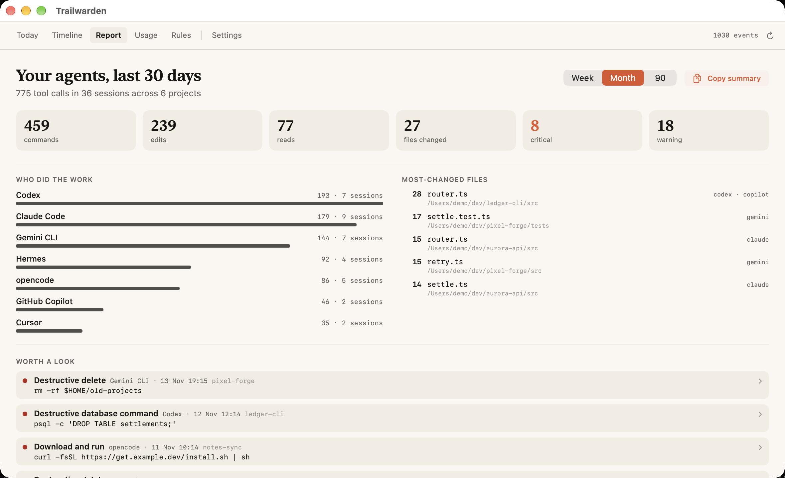
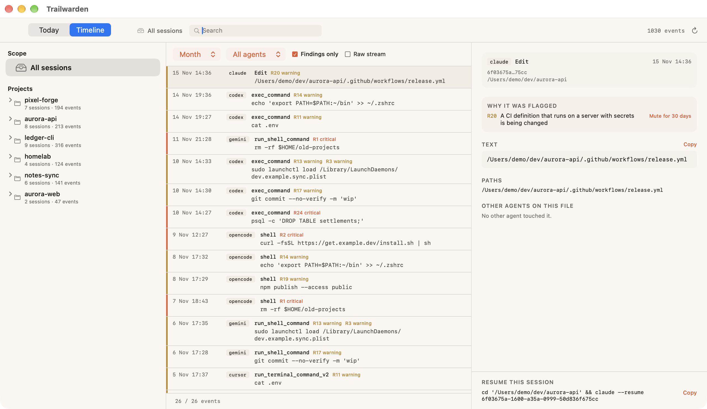
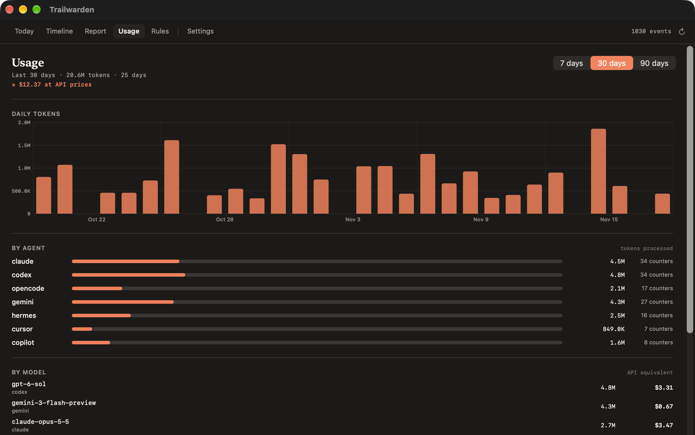

<!-- SPDX-License-Identifier: Apache-2.0 -->

# Trailwarden

[English](README.md) · [Türkçe](README.tr.md) · [Deutsch](README.de.md) · [Español](README.es.md) · [Italiano](README.it.md) · **Français**

**Le journal d'audit de tes agents de code.** Claude Code, Codex, Gemini CLI,
opencode, Cursor, GitHub Copilot et Hermes Agent notent déjà tout ce qu'ils font sur ton Mac. Trailwarden lit
ces transcriptions, te prévient dès qu'un agent lance quelque chose de risqué, montre quel
agent a touché quel fichier, et résume un mois de travail des agents en une page que tu peux
lire, ou transmettre à quelqu'un d'autre, masquée.

Rien de ce que font tes agents ne quitte la machine : pas de compte, pas de serveur, pas de
télémétrie. Le seul appel réseau de l'app est la vérification des mises à jour : un GET pour un
petit fichier JSON sur la dernière version GitHub, déclenché quand tu cliques dessus ou, si tu
l'actives dans les Réglages, au plus une fois par semaine ou par mois (désactivé par défaut). La CI échoue
si une API réseau apparaît ailleurs dans `Sources/`.

> État : **v0.2.2** — veille en direct, 27 règles, agent blame, rapport, garde-fou CI.
> Interface en anglais (US), turc, allemand, espagnol, italien et français.



## Pourquoi

Un agent qui a lancé 400 commandes pendant la nuit laisse trois choses : des fichiers `.jsonl`
bruts, une longue conversation et une vague impression. Trailwarden répond aux questions que
cette impression soulève :

| Question | Où |
|---|---|
| Un agent vient-il de faire quelque chose que j'aurais arrêté ? | **Veille en direct** — une notification en quelques secondes |
| Quel agent a modifié ce fichier, et quand ? | `trailwarden who <file>` · panneau de détail · MCP |
| Qu'ont fait mes agents ce mois-ci ? | **Rapport** |
| La CI peut-elle échouer quand un agent a fait quelque chose de risqué ? | `trailwarden scan --fail-on critical` |
| Qu'est-ce qui a été exécuté exactement, et comment reprendre cette session ? | **Chronologie** + commande de reprise |

## Captures d'écran

En clair, avec la chronologie, les filtres et l'inspecteur :



En sombre, sur l'écran Utilisation :



Chaque capture d'écran est prise sur une base de données inventée (`scripts/seed-demo.py`),
donc aucun vrai projet n'y apparaît.

## Ce qu'il fait

- **Veille en direct** — FSEvents prévient Trailwarden dès qu'un agent ajoute des lignes à sa
  transcription ; les nouvelles lignes sont analysées, les règles s'exécutent, et un constat
  critique devient une notification macOS. Clique dessus et la chronologie s'ouvre sur cet événement.
  Pas de polling, pas de démon, rien n'est envoyé nulle part. Le même flux est disponible dans le
  terminal : `trailwarden watch`.
- **27 règles de risque** — suppressions destructrices, `curl … | sh`, lectures de secrets et du
  trousseau, clés d'API collées dans une commande, `--dangerously-skip-permissions`,
  `git commit --no-verify`, persistance via launchd/cron, modifications du démarrage du shell et des
  réglages des agents, modifications des workflows CI, `DROP TABLE`, `terraform destroy`, effacement
  de disque, reverse shells, Gatekeeper/SIP désactivés, et un agent qui supprime ses propres
  transcriptions. Chaque règle est une donnée dans [`rules.json`](Sources/TrailwardenCore/Resources/rules.json)
  et possède un tableau de commandes qui doivent et ne doivent pas correspondre.
- **Agent blame** — `trailwarden who src/App.swift` liste chaque agent qui a
  modifié, lu ou lancé une commande sur un fichier, du plus récent au plus ancien, avec la commande pour
  reprendre la session qui l'a modifié en dernier. Fonctionne aussi sur les dossiers.
- **Rapport** — un mois de travail des agents sur une page : commandes, modifications, fichiers
  modifiés, qui a fait le travail, les fichiers les plus modifiés et les constats qui méritent
  un coup d'œil. « Copier le résumé » te donne uniquement des totaux et des noms de règles, sans risque à coller.
- **Chronologie** — chaque session, chaque appel d'outil, regroupés par projet, avec la
  branche et le répertoire de travail dans lesquels l'agent tournait.
- **Garde-fou CI** — `trailwarden scan --since 1d --fail-on critical` renvoie le code 1 quand un
  constat égal ou supérieur au seuil se trouve dans la fenêtre.
- **Export d'audit** — `trailwarden export --md` produit un enregistrement lisible et masqué
  pour une plage de dates (les clés d'API, jetons, clés privées et longs blocs base64
  sont masqués ; les chemins du dossier personnel sont raccourcis en `~`).
- **Utilisation** — un graphique des tokens sur 30 jours et une répartition par agent, à partir des compteurs
  que les agents écrivent déjà. Aucun prix n'est affiché : un même token ne coûte pas la même somme
  selon le forfait et le modèle.
- **Reprendre** — la commande exacte pour continuer à partir d'une session (`claude --resume`,
  `codex resume`, `gemini --resume`, `opencode --session`, `hermes --resume`),
  correctement échappée et prête à copier.
- **Serveur MCP** — `trailwarden-mcp` parle JSON-RPC sur stdio pour que d'autres agents
  puissent poser les mêmes questions (`search_events`, `list_sessions`, `get_event`,
  `file_history`, `audit_summary`). `file_history` permet à un agent de vérifier qui d'autre
  travaille sur un fichier avant de le modifier.

Le nouveau « code mode » de Codex enveloppe chaque appel dans un petit programme JavaScript ;
Trailwarden en extrait les commandes shell et les fichiers modifiés, de sorte que la
chronologie affiche `git push --force`, et non `text(await tools.exec_command({cmd:…`.
Codex compresse les anciennes sessions en `.jsonl.zst` ; Trailwarden les lit aussi,
avec le décodeur Zstandard officiel intégré (aucune installation supplémentaire), si bien que des mois
d'historique Codex ne manquent pas dans la chronologie.

Les agents qui gardent leur historique dans SQLite (Hermes : `~/.hermes/state.db`, opencode :
`~/.local/share/opencode/opencode.db`) sont lus de façon incrémentale via un
filigrane, donc une analyse ne traite que ce qui est nouveau. Seules les tables d'historique sont lues ;
la table `credential` d'opencode n'est jamais ouverte.

Cursor garde ses conversations d'agent dans la base d'état de l'éditeur
(`~/Library/Application Support/Cursor/User/globalStorage/state.vscdb`).
Trailwarden n'y lit que les enregistrements de conversations et d'étapes (`composerData:*`,
`bubbleId:*`), jamais les réglages de l'éditeur ni les données de connexion stockées à côté.
L'agent de GitHub Copilot (le Copilot CLI et l'app Copilot) écrit un journal par
session dans `~/.copilot/session-state/<id>/events.jsonl` ; ce journal est lu
comme n'importe quelle transcription. Copilot Chat dans VS Code n'est pas encore pris en charge.

C'est un **observateur en lecture seule** : Trailwarden ne lance pas d'agents, ne les intercepte
pas et ne modifie pas leurs fichiers. Il lit `~/.claude`, `~/.codex`, `~/.gemini`,
`~/.copilot` et les bases de données ci-dessus comme tu le ferais toi-même, et garde son propre index SQLite dans
`~/Library/Application Support/Trailwarden/`.

## Installation

```bash
brew trust tnalbant/trailwarden   # once: recent Homebrew asks before using a third-party tap
brew tap tnalbant/trailwarden     # once
```

| Méthode | Installe |
|---|---|
| `brew install --cask trailwarden` | app de la barre des menus |
| `brew install trailwarden-cli` | CLI + serveur MCP |
| DMG depuis [Releases](https://github.com/tnalbant/trailwarden/releases) | app de la barre des menus |
| `npm install -g trailwarden-mcp` | serveur MCP |
| `git clone … && make install` | CLI + serveur MCP |

Voir [docs/INSTALL.md](docs/INSTALL.md) (en anglais) pour chaque méthode, y compris pour brancher
le serveur MCP dans un client.

## Prérequis

- macOS 14 (Sonoma) ou plus récent
- Toolchain Swift 6 (Xcode 16+) pour compiler depuis les sources

## Ligne de commande

```bash
trailwarden scan                           # index new transcript lines, list findings
trailwarden watch                          # live: print each finding as it happens
trailwarden who Sources/App.swift          # which agent touched this file
trailwarden scan --since 1d --fail-on warn # CI gate: exit 1 on a warning or worse
trailwarden export --md --since 7d > audit.md
trailwarden rules test "git push --force origin main"
trailwarden rules apply                    # re-run the rules over the whole index
trailwarden doctor
```

Codes de sortie : `0` rien à signaler, `1` constats égaux ou supérieurs à `--fail-on` (par défaut `critical`),
`2` erreur d'utilisation.

## L'essayer sans tes propres données

```bash
swift build
python3 scripts/seed-demo.py /tmp/trailwarden-demo.sqlite   # 30 invented days, real rules

# after `xcodegen generate` + an xcodebuild, point the app at the demo index:
TRAILWARDEN_DB=/tmp/trailwarden-demo.sqlite \
  "$(xcodebuild -project Trailwarden.xcodeproj -scheme Trailwarden -configuration Debug \
      -showBuildSettings 2>/dev/null | awk -F' = ' '/ BUILT_PRODUCTS_DIR/ {print $2; exit}')/Trailwarden.app/Contents/MacOS/Trailwarden"
```

La CLI lit le même fichier : `trailwarden who --db /tmp/trailwarden-demo.sqlite src/router.ts`.

`TRAILWARDEN_DB` pointe l'app vers un autre index : la démo, ou une copie faite
pour un rapport de bug. La veille en direct reste désactivée pour un tel index (elle y écrirait tes
vraies transcriptions) sauf si `TRAILWARDEN_LIVE=1` est défini.

## Développement

```bash
swift build          # TrailwardenCore, trailwarden (CLI), trailwarden-mcp
swift test
xcodegen generate    # produces Trailwarden.xcodeproj for the menu-bar app
open Trailwarden.xcodeproj
```

Le projet Xcode est généré, pas versionné : `project.yml` fait foi.
Installe XcodeGen avec `brew install xcodegen`.

### Organisation

```
Sources/TrailwardenCore   parsers, event model, rule engine, store, redaction
Sources/CZstd             vendored Zstandard decompressor (BSD-3-Clause, unmodified)
Sources/TrailwardenCLI    `trailwarden` command line tool
Sources/TrailwardenMCP    stdio MCP server
Sources/TrailwardenApp    SwiftUI menu-bar app (driven by project.yml)
Tests/                  synthetic fixtures only — real transcripts are never committed
```

## Confidentialité

Trailwarden est conçu pour les personnes qui ne veulent pas que les transcriptions de leurs agents soient
envoyées quelque part. Deux règles en découlent, appliquées par la CI :

1. Aucun code réseau dans `Sources/`, à l'exception de la vérification des mises à jour dans
   `Sources/TrailwardenApp/Update/UpdateChecker.swift`, qui s'exécute quand tu cliques
   dessus, ou selon le rythme hebdomadaire/mensuel que tu peux activer dans les Réglages (désactivé par
   défaut). La CI vérifie les deux moitiés : une API réseau ailleurs fait échouer la compilation,
   et ce fichier qui perdrait sa raison d'être la fait échouer aussi. La veille en direct utilise
   FSEvents (notifications de changement de fichiers fournies par le noyau) et des notifications locales ;
   aucune des deux ne touche au réseau.
2. Aucune vraie transcription `.jsonl` dans le dépôt ; les tests n'utilisent que des fixtures
   synthétiques écrites à la main.

La base de données de l'index et chaque export sont écrits avec le mode `0600`. Le modèle de
menaces et la procédure de signalement se trouvent dans [THREATMODEL.md](THREATMODEL.md) et
[SECURITY.md](SECURITY.md).

## Licence

Apache-2.0. Chaque fichier source porte un en-tête SPDX.

### Logiciels tiers

- [swift-argument-parser](https://github.com/apple/swift-argument-parser)
  (Apache-2.0), uniquement pour la ligne de commande.
- [Zstandard](https://github.com/facebook/zstd) v1.5.7, décompresseur uniquement,
  Copyright (c) Meta Platforms, Inc. and affiliates, utilisé sous la
  licence BSD-3-Clause. Le texte de la licence se trouve dans
  [Sources/CZstd/LICENSE](Sources/CZstd/LICENSE) et est livré dans l'app sous le nom
  `Acknowledgements.txt`.
