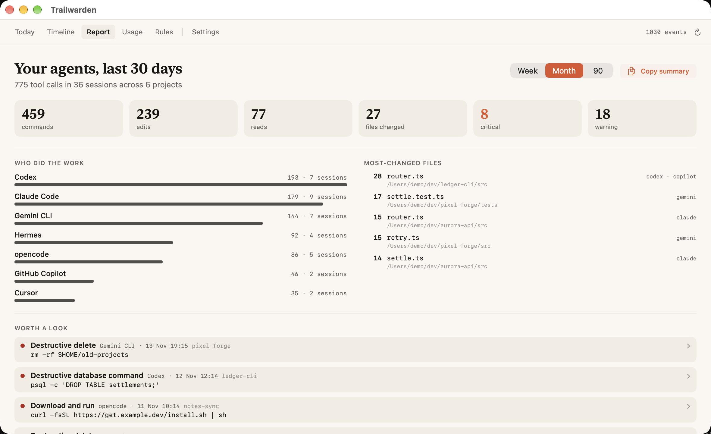
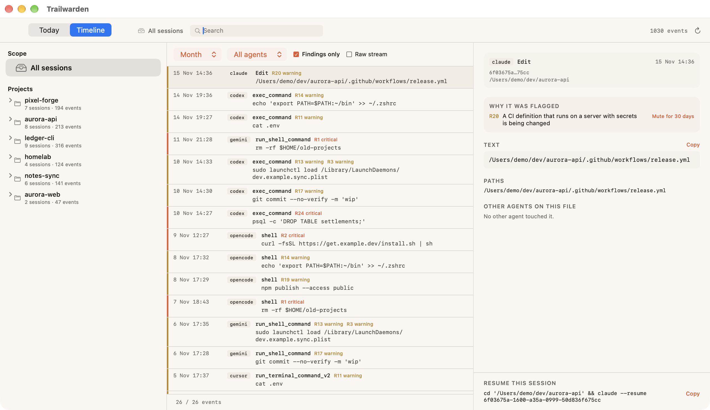
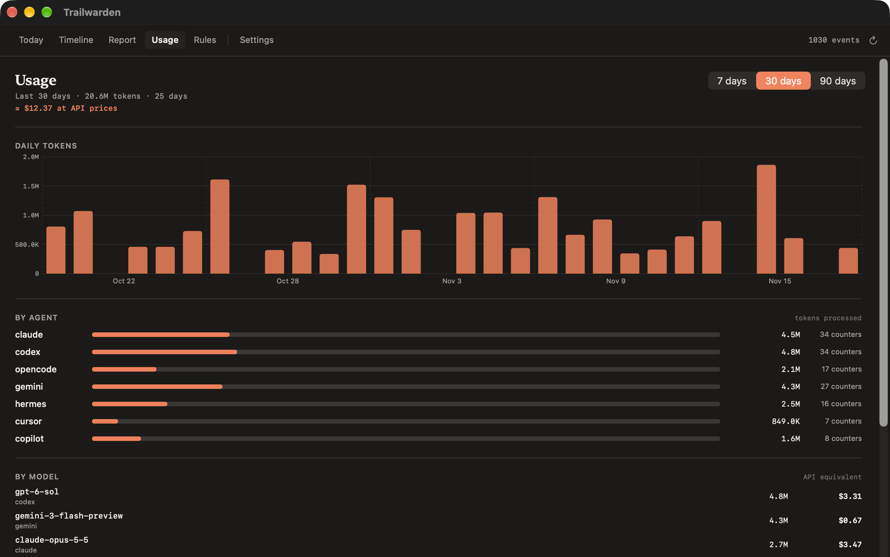

<!-- SPDX-License-Identifier: Apache-2.0 -->

# Trailwarden

[](https://github.com/tnalbant/trailwarden/actions/workflows/ci.yml) [](https://github.com/tnalbant/trailwarden/releases/latest)  [](LICENSE)

[English](README.md) · [Türkçe](README.tr.md) · [Deutsch](README.de.md) · [Español](README.es.md) · **Italiano** · [Français](README.fr.md)

**I tuoi agenti cancellano la loro cronologia. Trailwarden la conserva.**

**Il registro di controllo per i tuoi agenti di programmazione.** Claude Code, Codex, Gemini CLI,
opencode, Cursor, GitHub Copilot e Hermes Agent scrivono già tutto quello che fanno sul tuo Mac. Trailwarden legge
quelle trascrizioni, ti avvisa nel momento in cui un agente esegue qualcosa di rischioso, mostra quale
agente ha toccato quale file e trasforma un mese di lavoro degli agenti in una pagina che puoi
leggere, oppure passare a qualcun altro, con i dati sensibili mascherati.

Niente di ciò che riguarda i tuoi agenti lascia il computer: nessun account, nessun
server, nessuna telemetria. L'app va in rete solo per due cose, entrambe dallo stesso
file. La verifica degli aggiornamenti è una sola GET per un piccolo file JSON
nell'ultima release su GitHub, fatta quando premi il pulsante o, se la attivi nelle
Impostazioni, al massimo ogni settimana o ogni mese (disattivata per impostazione
predefinita). «Aggiorna prezzi» è una GET per il `prices.json` pubblico di questo
repository, usato per la stima dei costi, fatta solo quando lo premi. La CI fallisce
se compare un'API di rete in qualsiasi altro punto di `Sources/`.

> Stato: **v0.3.0** — posta in arrivo, permessi con ambito, titoli delle sessioni, archivio opzionale, 28 regole.
> Interfaccia in inglese (US), turco, tedesco, spagnolo, italiano e francese.



## Perché

Un agente che ha eseguito 400 comandi durante la notte lascia dietro di sé tre cose: file `.jsonl`
grezzi, una lunga chat e una vaga sensazione. Trailwarden risponde alle domande che
quella sensazione porta con sé:

| Domanda | Dove |
|---|---|
| Un agente ha appena fatto qualcosa che avrei fermato? | **Guardia live**: una notifica nel giro di pochi secondi |
| Quale agente ha modificato questo file, e quando? | `trailwarden who <file>` · pannello dei dettagli · MCP |
| Cosa hanno fatto i miei agenti questo mese? | **Rapporto** |
| La CI può fallire quando un agente ha fatto qualcosa di rischioso? | `trailwarden scan --fail-on critical` |
| Cosa è stato eseguito esattamente, e come riprendo quella sessione? | **Cronologia** + comando per riprendere |

## Screenshot

Chiaro, con la cronologia, i filtri e l'ispettore:



Scuro, nella schermata dell'utilizzo:



Ogni screenshot è fatto su un database inventato (`scripts/seed-demo.py`),
quindi non compare nessun progetto reale.

## Cosa fa

- **Posta in arrivo** — i rilevamenti che non hai ancora visto, i peggiori per primi. Segnali come Verificato, Previsto in questo progetto o Falso allarme; il badge nella barra dei menu conta solo i critici non verificati.
- **Permessi** — di' che un comando, una regola in un progetto, un modello o una regola ovunque va bene, per un giorno, 30 giorni o per sempre. Una corrispondenza permessa non notifica mai e resta fuori dalla posta. La scheda Regole li elenca.
- **Titoli** — le sessioni prendono il nome da ciò di cui parlano e la barra laterale le raggruppa in Oggi, Ieri, Questa settimana, Meno recenti. Se il file di origine sparisce, la sessione resta, con l'etichetta "Origine eliminata — conservata in Trailwarden".
- **Archivio (disattivato di default)** — una copia compressa delle trascrizioni di Claude Code, Codex, Gemini CLI e Copilot, così la pulizia dell'agente non le cancella. Privato (0600/0700), solo in aggiunta, in `~/Library/Application Support/Trailwarden/Archive/`.
- **Conservazione** — il registro è conservato per sempre di default; nelle Impostazioni puoi scegliere 1 anno o 90 giorni.
- **Guardia live**: FSEvents segnala a Trailwarden il momento in cui un agente aggiunge righe alla propria
  trascrizione; le nuove righe vengono analizzate, le regole girano e una segnalazione
  critica diventa una notifica di macOS. Cliccandola, la cronologia si apre su quell'evento.
  Niente polling, niente daemon e niente viene inviato altrove. Lo stesso flusso è disponibile nel
  terminale: `trailwarden watch`.
- **28 regole di rischio**: eliminazioni distruttive, `curl … | sh`, letture di segreti e del
  portachiavi, chiavi API incollate in un comando, `--dangerously-skip-permissions`,
  `git commit --no-verify`, persistenza tramite launchd/cron, modifiche ai file di avvio della shell e alle
  impostazioni degli agenti, modifiche ai workflow di CI, `DROP TABLE`, `terraform destroy`, cancellazione
  del disco, reverse shell, Gatekeeper/SIP disattivati e un agente che elimina le proprie
  trascrizioni. Ogni regola è un dato in [`rules.json`](Sources/TrailwardenCore/Resources/rules.json)
  e ha una tabella di comandi che devono e che non devono corrispondere.
- **Agent blame**: `trailwarden who src/App.swift` elenca ogni agente che ha
  modificato, letto o eseguito un comando su un file, dal più recente, con il comando per
  riprendere la sessione che l'ha modificato per ultima. Funziona anche sulle cartelle.
- **Rapporto**: un mese di lavoro degli agenti in una pagina: comandi, modifiche, file
  modificati, chi ha fatto il lavoro, i file più modificati e le segnalazioni che vale la pena
  guardare. «Copia riepilogo» ti dà solo conteggi e nomi delle regole, sicuri da incollare.
- **Cronologia**: ogni sessione, ogni chiamata a uno strumento, raggruppate per progetto, con il
  branch e la directory di lavoro in cui girava l'agente.
- **CI gate**: `trailwarden scan --since 1d --fail-on critical` termina con codice 1 quando una
  segnalazione pari o superiore alla soglia rientra nell'intervallo.
- **Esportazione del registro**: `trailwarden export --md` produce un resoconto leggibile e mascherato
  per un intervallo di date (chiavi API, token, chiavi private e lunghi blob base64
  vengono mascherati; i percorsi della home sono abbreviati in `~`).
- **Utilizzo**: un grafico dei token degli ultimi 30 giorni e una ripartizione per agente, ricavati dai contatori
  che gli agenti scrivono già, divisi per modello, con una stima del costo «equivalente
  API». È una stima, non una fattura: con un abbonamento gli stessi token costano altro.
  I prezzi sono inclusi, si aggiornano a mano e il prezzo che inserisci tu (o segni
  come gratuito) ha sempre la precedenza.
- **Riprendi**: il comando esatto per continuare da una sessione (`claude --resume`,
  `codex resume`, `gemini --resume`, `opencode --session`, `hermes --resume`),
  tra virgolette e pronto da copiare.
- **Server MCP**: `trailwarden-mcp` parla JSON-RPC su stdio, così altri agenti
  possono porre le stesse domande (`search_events`, `list_sessions`, `get_event`,
  `file_history`, `audit_summary`). `file_history` permette a un agente di controllare chi altro
  sta lavorando su un file prima di modificarlo.
- **Pensato per l'uso quotidiano**: avvio al login (se fallisce, lo mostra), dimensione del testo Standard, Grande o Più grande e righe semplici per impostazione predefinita: attiva «Mostra dettagli tecnici» per vedere gli id delle regole, i nomi grezzi degli strumenti e gli errori grezzi. VoiceOver legge ogni riga come una frase e la cronologia si usa con ↑/↓, ⏎, Esc e ⌘C.

La nuova «code mode» di Codex racchiude ogni chiamata in un piccolo programma JavaScript;
Trailwarden ne estrae i comandi shell e i file modificati, così la
cronologia mostra `git push --force`, non `text(await tools.exec_command({cmd:…`.
Codex comprime le sessioni più vecchie in `.jsonl.zst`; Trailwarden legge anche quelle,
con il decodificatore Zstandard ufficiale integrato (nessuna installazione aggiuntiva), così mesi di
cronologia di Codex non mancano nella cronologia.

Gli agenti che conservano la storia in SQLite (Hermes: `~/.hermes/state.db`, opencode:
`~/.local/share/opencode/opencode.db`) vengono letti
riprendendo da dove si era fermata la lettura precedente, quindi una scansione analizza solo ciò che è nuovo. Vengono lette solo le tabelle della cronologia;
la tabella `credential` di opencode non viene mai aperta.

Cursor conserva le chat dei suoi agenti nel database di stato dell'editor
(`~/Library/Application Support/Cursor/User/globalStorage/state.vscdb`).
Trailwarden ne legge solo i record delle chat e dei passaggi (`composerData:*`,
`bubbleId:*`), mai le impostazioni dell'editor né i dati di accesso conservati accanto.
L'agente di GitHub Copilot (la CLI di Copilot e l'app Copilot) scrive un log per
sessione in `~/.copilot/session-state/<id>/events.jsonl`; quel log viene letto
come qualsiasi trascrizione. Copilot Chat dentro VS Code non è ancora letto.

È un **osservatore di sola lettura**: Trailwarden non esegue gli agenti, non li intercetta
e non modifica i loro file. Legge `~/.claude`, `~/.codex`, `~/.gemini`,
`~/.copilot` e i database indicati sopra come faresti tu, e tiene il proprio indice SQLite in
`~/Library/Application Support/Trailwarden/`.

## Installazione

```bash
brew trust tnalbant/trailwarden   # once: recent Homebrew asks before using a third-party tap
brew tap tnalbant/trailwarden     # once
```

| Metodo | Installa |
|---|---|
| `brew install --cask trailwarden` | app nella barra dei menu |
| `brew install trailwarden-cli` | CLI + server MCP |
| DMG da [Releases](https://github.com/tnalbant/trailwarden/releases) | app nella barra dei menu |
| `npm install -g trailwarden-mcp` | server MCP |
| `git clone … && make install` | CLI + server MCP |

Vedi [docs/INSTALL.md](docs/INSTALL.md) (in inglese) per ogni metodo, incluso come collegare
il server MCP a un client.

## Requisiti

- macOS 14 (Sonoma) o successivo
- Toolchain Swift 6 (Xcode 16+) per compilare dai sorgenti

## Riga di comando

```bash
trailwarden scan                           # index new transcript lines, list findings
trailwarden watch                          # live: print each finding as it happens
trailwarden who Sources/App.swift          # which agent touched this file
trailwarden scan --since 1d --fail-on warn # CI gate: exit 1 on a warning or worse
trailwarden export --md --since 7d > audit.md
trailwarden rules test "git push --force origin main"
trailwarden rules apply                    # re-run the rules over the whole index
trailwarden scan --include-reviewed       # elenca anche i rilevamenti già verificati
trailwarden doctor --share                 # numeri per una segnalazione di bug: niente percorsi, comandi o nomi
trailwarden doctor --formats               # quali tipi di record scrivono i tuoi agenti
trailwarden doctor
```

Codici di uscita: `0` tutto a posto, `1` segnalazioni pari o superiori a `--fail-on` (predefinito `critical`),
`2` errore d'uso.

## Provalo senza i tuoi dati

```bash
swift build
python3 scripts/seed-demo.py /tmp/trailwarden-demo.sqlite   # 30 invented days, real rules

# after `xcodegen generate` + an xcodebuild, point the app at the demo index:
TRAILWARDEN_DB=/tmp/trailwarden-demo.sqlite \
  "$(xcodebuild -project Trailwarden.xcodeproj -scheme Trailwarden -configuration Debug \
      -showBuildSettings 2>/dev/null | awk -F' = ' '/ BUILT_PRODUCTS_DIR/ {print $2; exit}')/Trailwarden.app/Contents/MacOS/Trailwarden"
```

La CLI legge lo stesso file: `trailwarden who --db /tmp/trailwarden-demo.sqlite src/router.ts`.

`TRAILWARDEN_DB` fa puntare l'app, la CLI e il server MCP a un altro indice: quello demo,
oppure una copia fatta per una segnalazione di bug; da riga di comando prevale `--db`. La guardia live resta disattivata con un indice del genere (ci scriverebbe dentro le
tue trascrizioni reali) a meno che non sia impostato `TRAILWARDEN_LIVE=1`.

## Sviluppo

```bash
swift build          # TrailwardenCore, trailwarden (CLI), trailwarden-mcp
swift test
xcodegen generate    # produces Trailwarden.xcodeproj for the menu-bar app
open Trailwarden.xcodeproj
```

Il progetto Xcode viene generato, non versionato: la fonte di verità è `project.yml`.
Installa XcodeGen con `brew install xcodegen`.

### Struttura

```
Sources/TrailwardenCore   parsers, event model, rule engine, store, redaction
Sources/CZstd             vendored Zstandard decompressor (BSD-3-Clause, unmodified)
Sources/TrailwardenCLI    `trailwarden` command line tool
Sources/TrailwardenMCP    stdio MCP server
Sources/TrailwardenApp    SwiftUI menu-bar app (driven by project.yml)
Tests/                  synthetic fixtures only — real transcripts are never committed
```

## Privacy

Trailwarden è pensato per chi non vuole che le trascrizioni dei propri agenti vengano caricate
da nessuna parte. Ne derivano due regole, applicate dalla CI:

1. Nessun codice di rete in `Sources/` tranne la verifica degli aggiornamenti in
   `Sources/TrailwardenApp/Update/UpdateChecker.swift`, che gira quando premi il pulsante
   oppure con la cadenza settimanale/mensile che puoi attivare nelle Impostazioni (disattivata per
   impostazione predefinita). La CI controlla entrambe le metà: un'API di rete in qualsiasi altro punto fa fallire la build,
   e lo stesso vale se quel file perde la sua ragione di esistere. La guardia live usa
   FSEvents (notifiche di modifica dei file da parte del kernel) e notifiche locali;
   nessuna delle due tocca la rete.
2. Nessuna vera trascrizione `.jsonl` nel repository; i test usano solo fixture
   sintetiche scritte a mano.

Il database dell'indice e ogni esportazione vengono scritti con permessi `0600`. Il modello
di minaccia e la procedura di segnalazione si trovano in [THREATMODEL.md](THREATMODEL.md) e
[SECURITY.md](SECURITY.md).

## Licenza

Apache-2.0. Ogni file sorgente porta un'intestazione SPDX.

### Software di terze parti

- [swift-argument-parser](https://github.com/apple/swift-argument-parser)
  (Apache-2.0), solo per la riga di comando.
- [Zstandard](https://github.com/facebook/zstd) v1.5.7, solo il decompressore,
  Copyright (c) Meta Platforms, Inc. and affiliates, usato con licenza
  BSD-3-Clause. Il testo della licenza è in
  [Sources/CZstd/LICENSE](Sources/CZstd/LICENSE) e viene distribuito dentro l'app come
  `Acknowledgements.txt`.
