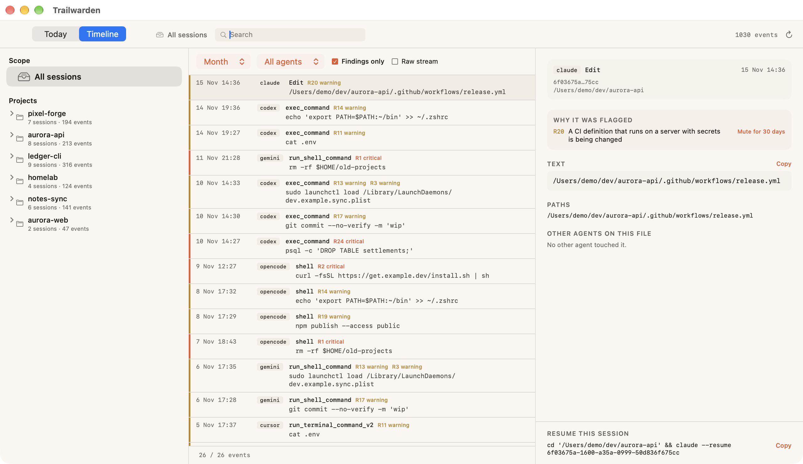
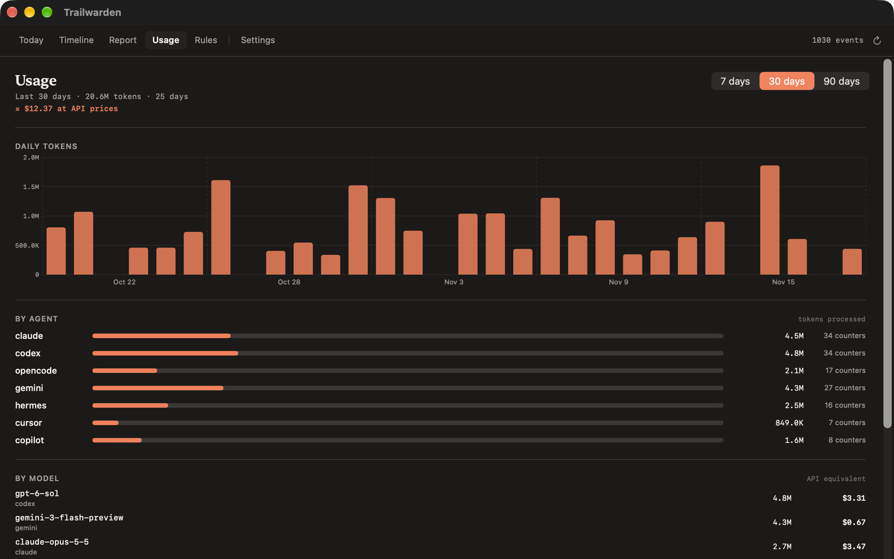

<!-- SPDX-License-Identifier: Apache-2.0 -->

# Trailwarden

**The audit trail for your coding agents.** Trailwarden reads the transcripts that
Claude Code, Codex, Gemini CLI and Hermes Agent already write to your Mac, turns them into a timeline you
can actually read, flags risky commands (wide `rm -rf`, secret-file access,
`curl … | sh`, force pushes), and exports a redacted audit record you can hand to
someone else.

Nothing leaves the machine: no account, no server, no telemetry, no network code
at all (CI fails if `URLSession` or friends ever show up in `Sources/`).

> Status: **v0.1.0** — works end to end, Turkish UI. The plan and the daily progress log live in
> the private project workspace; this repository is the product itself.

## Screenshots

Light, with the timeline, the filters and the inspector:



Dark, on the usage screen:



Both were taken against an invented database (`scripts/seed-demo.py`), so no
real project appears in them.

## What it does

- **Timeline** — every session, every tool call, grouped by project, with the
  branch and working directory the agent ran in.
- **Risk flags** — a data-driven rule set (10 rules in v1) marks the commands you
  would want to have seen before they ran: destructive deletes, `sudo`,
  credential-file reads, data posted to the network, force pushes.
- **Audit export** — `trailwarden export --md` produces a human-readable, redacted
  record for a date range (API keys, tokens, private keys and long base64 blobs
  are masked; home-directory paths are shortened to `~`).
- **Usage** — a 30-day token chart and a per-agent breakdown, from the counters
  the agents already write. No price is printed: the same token costs different
  money depending on plan and model.
- **Resume** — the exact command to carry on from a session (`claude --resume`,
  `codex resume`, `gemini --resume`), quoted and ready to copy.
- **Appearance** — follows macOS light/dark, or pinned in Settings.
- **MCP server** — `trailwarden-mcp` speaks JSON-RPC over stdio so other agents can
  query the same data (`trailwarden_sessions`, `trailwarden_events`,
  `trailwarden_audit`, `trailwarden_rules`).

Agents that keep history in SQLite (Hermes: `~/.hermes/state.db`) are read
incrementally through a watermark, so a scan only parses what is new.

It is a **read-only observer**: Trailwarden does not run agents, does not intercept
them, and does not modify their files. It reads `~/.claude`, `~/.codex` and `~/.gemini` the
same way you would, and keeps its own SQLite index under
`~/Library/Application Support/Trailwarden/`.

## Requirements

- macOS 14 (Sonoma) or later
- Swift 6 toolchain (Xcode 16+)

## Try it without your own data

```bash
python3 scripts/seed-demo.py /tmp/trailwarden-demo.sqlite

# after `xcodegen generate` + an xcodebuild, point the app at the demo index:
TRAILWARDEN_DB=/tmp/trailwarden-demo.sqlite \
  "$(xcodebuild -project Trailwarden.xcodeproj -scheme Trailwarden -configuration Debug \
      -showBuildSettings 2>/dev/null | awk -F' = ' '/ BUILT_PRODUCTS_DIR/ {print $2; exit}')/Trailwarden.app/Contents/MacOS/Trailwarden"
```

The CLI can read the same file: `trailwarden scan --db /tmp/trailwarden-demo.sqlite`.

`TRAILWARDEN_DB` points the app at another index — the demo, or a copy taken
for a bug report.

## Development

```bash
swift build          # TrailwardenCore, trailwarden (CLI), trailwarden-mcp
swift test
xcodegen generate    # produces Trailwarden.xcodeproj for the menu-bar app
open Trailwarden.xcodeproj
```

The Xcode project is generated, not committed: `project.yml` is the source of
truth. Install XcodeGen with `brew install xcodegen`.

### Layout

```
Sources/TrailwardenCore   parsers, event model, rule engine, store, redaction
Sources/TrailwardenCLI    `trailwarden` command line tool
Sources/TrailwardenMCP    stdio MCP server
Sources/TrailwardenApp    SwiftUI menu-bar app (driven by project.yml)
Tests/                  synthetic fixtures only — real transcripts are never committed
```

## Privacy

Trailwarden is built for people who do not want their agent transcripts uploaded
anywhere. Two rules follow from that and are enforced in CI:

1. No networking code in `Sources/`.
2. No real `.jsonl` transcript in the repository; tests use hand-written
   synthetic fixtures only.

The index database and every export are written with mode `0600`. The threat
model and the reporting process live in [THREATMODEL.md](THREATMODEL.md) and
[SECURITY.md](SECURITY.md).

## License

Apache-2.0. Every source file carries an SPDX header.
