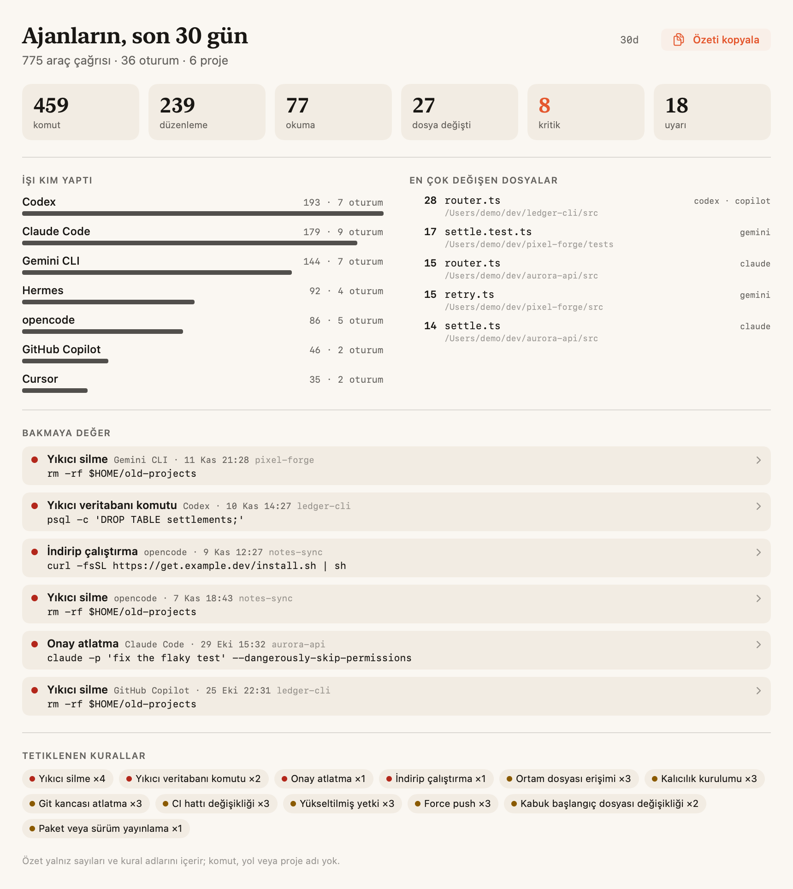
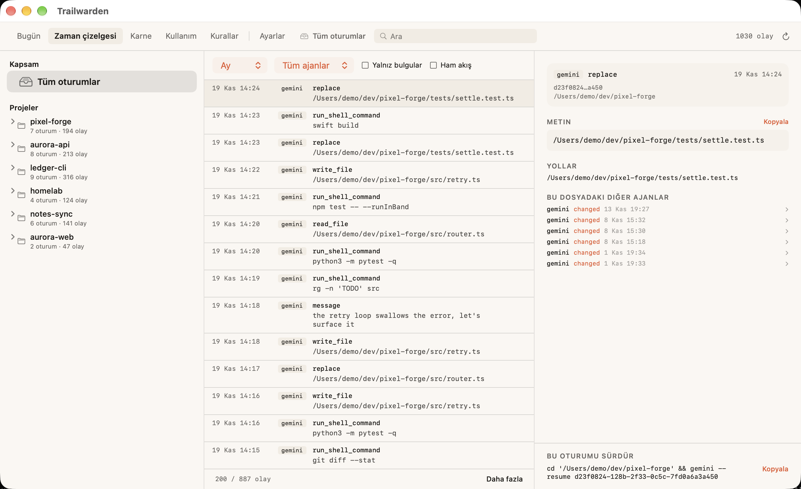
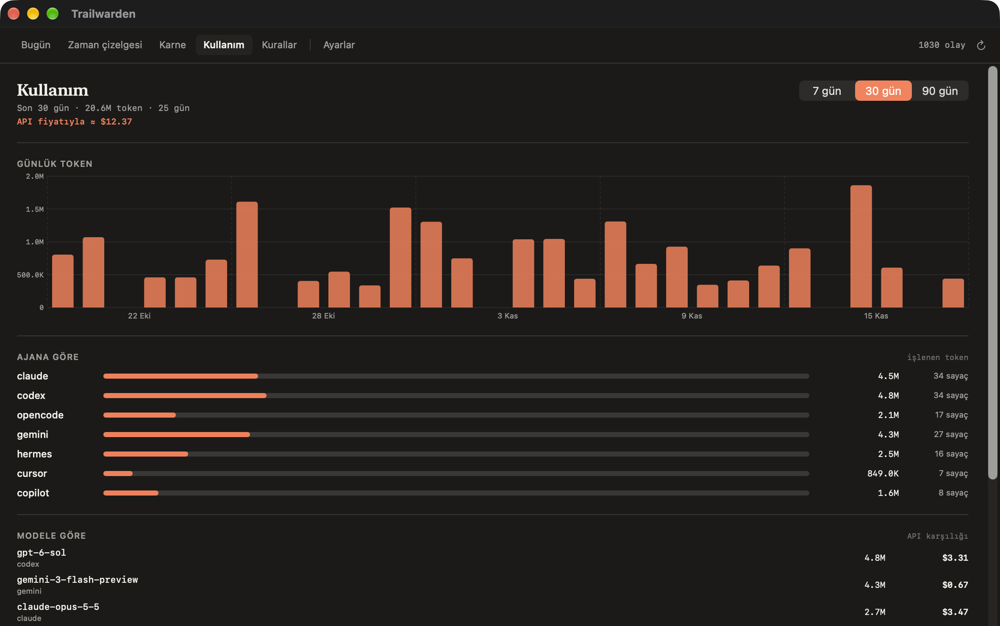

<!-- SPDX-License-Identifier: Apache-2.0 -->

# Trailwarden

[](https://github.com/tnalbant/trailwarden/actions/workflows/ci.yml) [](https://github.com/tnalbant/trailwarden/releases/latest)  [](LICENSE)

[English](README.md) · **Türkçe** · [Deutsch](README.de.md) · [Español](README.es.md) · [Italiano](README.it.md) · [Français](README.fr.md)

**Ajanların geçmişini siler. Trailwarden saklar.**

**Kodlama ajanların için denetim kaydı.** Claude Code, Codex, Gemini CLI,
opencode, Cursor, GitHub Copilot ve Hermes Agent yaptıkları her şeyi zaten Mac'inde
bir yere yazıyor. Trailwarden bu transkriptleri okur, bir ajan riskli bir şey
çalıştırdığı anda sana haber verir, hangi ajanın hangi dosyaya dokunduğunu gösterir
ve bir aylık ajan işini tek sayfalık, okunabilir bir özete çevirir. İstersen bu
özeti maskelenmiş halde başkasına verebilirsin.

Ajanlarına dair hiçbir şey makineden çıkmaz: hesap yok, sunucu yok, telemetri yok.
Uygulama yalnızca iki şey için ağa çıkar ve ikisi de aynı dosyadadır. Güncelleme
denetimi, en yeni GitHub sürümündeki küçük bir JSON dosyası için tek bir GET
isteğidir. Sen tıkladığında yapılır; Ayarlar'dan açarsan en fazla haftada veya ayda
bir de kendiliğinden yapılır (varsayılan olarak kapalıdır). "Fiyatları güncelle" ise
maliyet tahmini için bu depodaki herkese açık `prices.json` dosyasını çeken tek bir
GET'tir ve yalnızca sen tıkladığında yapılır. `Sources/` altında başka herhangi bir
yerde ağ API'si görünürse CI başarısız olur.

> Durum: **v0.3.0** — gelen kutusu, kapsamlı izinler, oturum başlıkları, isteğe bağlı arşiv, 28 kural.
> Arayüz İngilizce (ABD), Türkçe, Almanca, İspanyolca, İtalyanca ve Fransızca.



## Neden

Gece boyunca 400 komut çalıştıran bir ajan geride üç şey bırakır: ham `.jsonl`
dosyaları, uzun bir sohbet ve belirsiz bir tedirginlik. Trailwarden bu tedirginliğin
ardındaki soruları yanıtlar:

| Soru | Nerede |
|---|---|
| Bir ajan az önce benim durduracağım bir şey mi yaptı? | **Canlı bekçi** — birkaç saniye içinde bildirim |
| Bu dosyayı hangi ajan, ne zaman değiştirdi? | `trailwarden who <dosya>` · ayrıntı paneli · MCP |
| Ajanlarım bu ay ne yaptı? | **Karne** |
| Bir ajan riskli bir şey yaptığında CI başarısız olabilir mi? | `trailwarden scan --fail-on critical` |
| Tam olarak ne çalıştı, o oturumu nasıl sürdürürüm? | **Zaman çizelgesi** + sürdürme komutu |

## Ekran görüntüleri

Açık temada zaman çizelgesi, filtreler ve denetçi paneli:



Koyu temada kullanım ekranı:



Bütün ekran görüntüleri uydurma bir veritabanından alındı (`scripts/seed-demo.py`),
bu yüzden hiçbirinde gerçek bir proje görünmez.

## Ne yapar

- **Gelen kutusu** — henüz bakmadığın bulgular, en kötüsü başta. Birini Gözden geçirildi, Bu projede beklenen ya da Yanlış alarm diye işaretle; menü çubuğundaki rozet yalnızca gözden geçirilmemiş kritik bulguları sayar.
- **İzinler** — bir komutun, bir projedeki bir kuralın, bir desenin ya da her yerde bir kuralın sorun olmadığını bir gün, 30 gün ya da süresiz söyle. İzinli eşleşmeler bildirim üretmez, gelen kutusuna girmez. Kurallar sekmesi hepsini listeler.
- **Başlıklar** — oturumlar ne hakkında olduklarıyla adlanır; kenar çubuğu onları Bugün, Dün, Bu hafta, Daha eski diye gruplar. Kaynak dosyası silinen oturum kalır, "Kaynak silindi — Trailwarden'da saklanıyor" diye işaretlenir.
- **Arşiv (varsayılan kapalı)** — Claude Code, Codex, Gemini CLI ve Copilot transkriptlerinin sıkıştırılmış kopyası; ajan temizlik yapsa da silinmez. Özel (0600/0700), yalnızca eklenir, `~/Library/Application Support/Trailwarden/Archive/` altında.
- **Saklama** — kayıt varsayılan olarak sonsuza kadar tutulur; Ayarlar'dan 1 yıl ya da 90 gün seçilebilir.
- **Canlı bekçi** — Bir ajan transkriptine satır eklediği anda FSEvents bunu
  Trailwarden'a bildirir. Yeni satırlar ayrıştırılır, kurallar çalışır ve kritik
  bir bulgu macOS bildirimine dönüşür. Bildirime tıklayınca zaman çizelgesi o
  olayda açılır. Yoklama yok, arka plan servisi yok, hiçbir yere bir şey
  gönderilmez. Aynı akış terminalde de var: `trailwarden watch`.
- **28 risk kuralı** — yıkıcı silmeler, `curl … | sh`, gizli bilgi ve anahtarlık
  okumaları, komuta yapıştırılmış API anahtarları, `--dangerously-skip-permissions`,
  `git commit --no-verify`, launchd/cron ile kalıcılık, kabuk başlangıç dosyalarında
  ve ajan ayarlarında yapılan düzenlemeler, CI iş akışı düzenlemeleri, `DROP TABLE`,
  `terraform destroy`, disk silme, ters kabuklar (reverse shell), Gatekeeper/SIP'in
  kapatılması ve bir ajanın kendi transkriptlerini silmesi. Her kural
  [`rules.json`](Sources/TrailwardenCore/Resources/rules.json) içinde veri olarak
  durur ve eşleşmesi gereken ve eşleşmemesi gereken komutların bir tablosu vardır.
- **Ajan izi** — `trailwarden who src/App.swift`, bir dosyayı değiştiren, okuyan
  veya o dosya üzerinde komut çalıştıran her ajanı en yeniden başlayarak listeler.
  Dosyayı en son değiştiren oturumu sürdürme komutunu da verir. Klasörlerde de
  çalışır.
- **Karne** — Bir aylık ajan işi tek sayfada: komutlar, düzenlemeler, değişen
  dosyalar, işi kimin yaptığı, en çok değişen dosyalar ve bakmaya değer bulgular.
  "Özeti kopyala" yalnızca sayıları ve kural adlarını verir, yapıştırması güvenlidir.
- **Zaman çizelgesi** — Her oturum, her araç çağrısı, projeye göre gruplanmış;
  ajanın çalıştığı dal ve çalışma dizini de görünür.
- **CI kapısı** — `trailwarden scan --since 1d --fail-on critical`, pencere içinde
  eşik düzeyinde veya üstünde bir bulgu varsa 1 koduyla çıkar.
- **Denetim dışa aktarımı** — `trailwarden export --md`, bir tarih aralığı için
  insanın okuyabileceği, maskelenmiş bir kayıt üretir (API anahtarları, jetonlar,
  özel anahtarlar ve uzun base64 blokları maskelenir; ev dizini yolları `~` olarak
  kısaltılır).
- **Kullanım** — Ajanların zaten yazdığı sayaçlardan 30 günlük bir token grafiği
  ve ajan başına döküm; model bazında ayrılır ve "API karşılığı" bir maliyet
  tahmini gösterir. Bu bir fatura değil, tahmindir: abonelikte aynı token başka
  bir tutara denk gelir. Fiyatlar uygulamayla gelir, elle güncellenebilir ve
  senin girdiğin (ya da ücretsiz işaretlediğin) fiyat her zaman önceliklidir.
- **Sürdürme** — Bir oturumdan devam etmek için tam komut (`claude --resume`,
  `codex resume`, `gemini --resume`, `opencode --session`, `hermes --resume`),
  tırnaklanmış ve kopyalamaya hazır.
- **MCP sunucusu** — `trailwarden-mcp`, stdio üzerinden JSON-RPC konuşur; böylece
  başka ajanlar da aynı soruları sorabilir (`search_events`, `list_sessions`,
  `get_event`, `file_history`, `audit_summary`). `file_history`, bir ajanın bir
  dosyayı düzenlemeden önce o dosya üzerinde başka kimin çalıştığına bakmasını
  sağlar.
- **Günlük kullanıma uygun** — girişte başlatma (başarısız olursa gösterilir, gizlenmez), Standart, Büyük ve Daha büyük yazı boyutu ve varsayılan olarak sade satırlar: kural kimliklerini, ham araç adlarını ve ham hataları görmek için "Teknik ayrıntıları göster"i açın. VoiceOver her satırı tek cümle olarak okur; zaman çizelgesi ↑/↓, ⏎, Esc ve ⌘C ile kullanılır.

Codex'in yeni "code mode"u her çağrıyı küçük bir JavaScript programına sarar.
Trailwarden kabuk komutlarını ve yamalanan dosyaları bu programın içinden çıkarır;
böylece zaman çizelgesinde `text(await tools.exec_command({cmd:…` yerine
`git push --force` görünür. Codex eski oturumları `.jsonl.zst` olarak sıkıştırır;
Trailwarden bunları da okur. Resmi Zstandard çözücüsü uygulamanın içindedir (ek
kurulum gerekmez), böylece aylarca Codex geçmişi zaman çizelgesinde eksik kalmaz.

Geçmişini SQLite'ta tutan ajanlar (Hermes: `~/.hermes/state.db`, opencode:
`~/.local/share/opencode/opencode.db`) kaldığı yerden okunur:
her tarama yalnızca yeni kayıtları ayrıştırır. Yalnızca geçmiş tabloları okunur;
opencode'un `credential` tablosu hiç açılmaz.

Cursor ajan sohbetlerini editörün durum veritabanında tutar
(`~/Library/Application Support/Cursor/User/globalStorage/state.vscdb`).
Trailwarden bunun içinden yalnızca sohbet ve adım kayıtlarını (`composerData:*`,
`bubbleId:*`) okur; yanlarında duran editör ayarlarına ve oturum açma verilerine
asla dokunmaz. GitHub Copilot'un ajanı (Copilot CLI ve Copilot uygulaması) her
oturum için `~/.copilot/session-state/<id>/events.jsonl` altına bir günlük yazar;
bu günlük, diğer transkriptler gibi okunur. VS Code içindeki Copilot Chat henüz
okunmuyor.

Trailwarden **salt okunur bir gözlemcidir**: ajan çalıştırmaz, ajanları araya
girerek denetlemez, onların dosyalarını değiştirmez. `~/.claude`, `~/.codex`,
`~/.gemini`, `~/.copilot` ve yukarıdaki veritabanlarını senin okuyacağın şekilde
okur. Kendi SQLite indeksini `~/Library/Application Support/Trailwarden/` altında
tutar.

## Kurulum

```bash
brew trust tnalbant/trailwarden   # once: recent Homebrew asks before using a third-party tap
brew tap tnalbant/trailwarden     # once
```

| Yöntem | Ne kurar |
|---|---|
| `brew install --cask trailwarden` | menü çubuğu uygulaması |
| `brew install trailwarden-cli` | CLI + MCP sunucusu |
| [Releases](https://github.com/tnalbant/trailwarden/releases) sayfasından DMG | menü çubuğu uygulaması |
| `npm install -g trailwarden-mcp` | MCP sunucusu |
| `git clone … && make install` | CLI + MCP sunucusu |

Her yöntemin ayrıntısı ve MCP sunucusunu bir istemciye bağlama için
[docs/INSTALL.tr.md](docs/INSTALL.tr.md) dosyasına bak.

## Gereksinimler

- macOS 14 (Sonoma) veya üstü
- Kaynaktan derlerken Swift 6 araç zinciri (Xcode 16+)

## Komut satırı

```bash
trailwarden scan                           # index new transcript lines, list findings
trailwarden watch                          # live: print each finding as it happens
trailwarden who Sources/App.swift          # which agent touched this file
trailwarden scan --since 1d --fail-on warn # CI gate: exit 1 on a warning or worse
trailwarden export --md --since 7d > audit.md
trailwarden rules test "git push --force origin main"
trailwarden rules apply                    # re-run the rules over the whole index
trailwarden scan --include-reviewed       # gözden geçirdiğin bulguları da listele
trailwarden doctor --share                 # hata raporu için sayılar: yol, komut ya da ad yok
trailwarden doctor --formats               # ajanların hangi kayıt türlerini yazıyor
trailwarden doctor
```

Çıkış kodları: `0` temiz, `1` `--fail-on` düzeyinde (varsayılan `critical`) veya
üstünde bulgu var, `2` kullanım hatası.

## Kendi verin olmadan dene

```bash
swift build
python3 scripts/seed-demo.py /tmp/trailwarden-demo.sqlite   # 30 invented days, real rules

# after `xcodegen generate` + an xcodebuild, point the app at the demo index:
TRAILWARDEN_DB=/tmp/trailwarden-demo.sqlite \
  "$(xcodebuild -project Trailwarden.xcodeproj -scheme Trailwarden -configuration Debug \
      -showBuildSettings 2>/dev/null | awk -F' = ' '/ BUILT_PRODUCTS_DIR/ {print $2; exit}')/Trailwarden.app/Contents/MacOS/Trailwarden"
```

CLI aynı dosyayı okur: `trailwarden who --db /tmp/trailwarden-demo.sqlite src/router.ts`.

`TRAILWARDEN_DB`, uygulamayı, komut satırı aracını ve MCP sunucusunu başka bir
indekse yönlendirir: demoya ya da hata bildirimi için alınmış bir kopyaya. Komut
satırında `--db` verilirse o geçerli olur. Böyle bir indeks için canlı bekçi kapalı kalır
(yoksa gerçek transkriptlerini içine yazardı); `TRAILWARDEN_LIVE=1` verilirse açılır.

## Geliştirme

```bash
swift build          # TrailwardenCore, trailwarden (CLI), trailwarden-mcp
swift test
xcodegen generate    # produces Trailwarden.xcodeproj for the menu-bar app
open Trailwarden.xcodeproj
```

Xcode projesi üretilir, repoya eklenmez: gerçek kaynak `project.yml` dosyasıdır.
XcodeGen'i `brew install xcodegen` ile kurabilirsin.

### Yapı

```
Sources/TrailwardenCore   parsers, event model, rule engine, store, redaction
Sources/CZstd             vendored Zstandard decompressor (BSD-3-Clause, unmodified)
Sources/TrailwardenCLI    `trailwarden` command line tool
Sources/TrailwardenMCP    stdio MCP server
Sources/TrailwardenApp    SwiftUI menu-bar app (driven by project.yml)
Tests/                  synthetic fixtures only — real transcripts are never committed
```

## Gizlilik

Trailwarden, ajan transkriptlerinin hiçbir yere yüklenmesini istemeyen insanlar için
yapıldı. Bundan iki kural çıkar ve ikisi de CI'da zorunlu tutulur:

1. `Sources/` altında ağ kodu yoktur; tek istisna
   `Sources/TrailwardenApp/Update/UpdateChecker.swift` içindeki güncelleme
   denetimidir. Bu denetim, sen tıkladığında ya da Ayarlar'dan açabileceğin
   haftalık/aylık takvimde çalışır (varsayılan olarak kapalı). CI bunun iki
   yanını da denetler: başka bir yerde görünen ağ API'si derlemeyi bozar, o dosya
   da varlık nedenini yitirirse derleme yine bozulur. Canlı bekçi FSEvents'i
   (çekirdekten gelen dosya değişikliği bildirimleri) ve yerel bildirimleri
   kullanır; ikisi de ağa dokunmaz.
2. Repoda gerçek bir `.jsonl` transkripti yoktur; testler yalnızca elle yazılmış
   sentetik örnekler kullanır.

İndeks veritabanı ve her dışa aktarım `0600` izniyle yazılır. Tehdit modeli ve
bildirme süreci [THREATMODEL.tr.md](THREATMODEL.tr.md) ve
[SECURITY.tr.md](SECURITY.tr.md) dosyalarındadır.

## Lisans

Apache-2.0. Her kaynak dosyada bir SPDX başlığı bulunur.

### Üçüncü taraf yazılımlar

- [swift-argument-parser](https://github.com/apple/swift-argument-parser)
  (Apache-2.0), yalnızca komut satırı.
- [Zstandard](https://github.com/facebook/zstd) v1.5.7, yalnızca çözücü,
  Telif hakkı (c) Meta Platforms, Inc. ve bağlı kuruluşları, BSD-3-Clause
  lisansı altında kullanılır. Lisans metni
  [Sources/CZstd/LICENSE](Sources/CZstd/LICENSE) dosyasındadır ve uygulamanın
  içinde `Acknowledgements.txt` olarak gönderilir.
